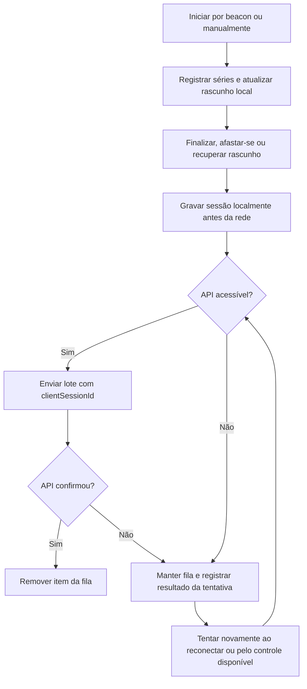

<p align="center">
  <picture>
    <source media="(prefers-color-scheme: light)" srcset="app/assets/brand/logo-fitbeacon-claro.png">
    
  </picture>
</p>

<h1 align="center">FitBeacon</h1>
<p align="center"><strong>Tecnologia que te guia no seu treino.</strong></p>

O FitBeacon aproxima o aluno do equipamento certo usando beacons iBeacon.
O app registra séries e sessões com consentimento explícito e mantém uma fila local para uso sem conexão.
Uma API centraliza autenticação e dados; o painel apresenta indicadores agregados e ferramentas da academia.

## Índice

- [Visão geral](#visão-geral)
- [Funcionalidades](#funcionalidades)
- [Telas e galeria](#telas-e-galeria)
- [Como funciona](#como-funciona)
- [Arquitetura e stack](#arquitetura-e-stack)
- [Estrutura de pastas](#estrutura-de-pastas)
- [Pré-requisitos](#pré-requisitos)
- [Instalação e execução](#instalação-e-execução)
- [Atualizar o app no celular](#atualizar-o-app-no-celular)
- [Variáveis de ambiente](#variáveis-de-ambiente)
- [Mock e testes sem beacon](#mock-e-testes-sem-beacon)
- [Beacon real e calibração](#beacon-real-e-calibração)
- [Regras de treino](#regras-de-treino)
- [Modelo de dados](#modelo-de-dados)
- [Privacidade e segurança](#privacidade-e-segurança)
- [Dados de demonstração e dados reais](#dados-de-demonstração-e-dados-reais)
- [Testes](#testes)
- [Scripts e operações administrativas](#scripts-e-operações-administrativas)
- [Solução de problemas](#solução-de-problemas)
- [Limitações e próximos passos](#limitações-e-próximos-passos)
- [Contribuição, licença e autoria](#contribuição-licença-e-autoria)

## Visão geral

Em academias, o aluno pode ter dificuldade para identificar um aparelho e acompanhar o próprio treino. O FitBeacon associa beacons instalados nos equipamentos ao catálogo da academia e oferece um fluxo de treino contextual no celular. A solução é composta pelo app do aluno, uma API REST e um painel web administrativo.

## Funcionalidades

**Aluno:** cadastro e consentimento, localização de equipamento por beacon ou seleção manual, instruções de exercício, registro de séries e descanso, histórico, preferências de tema, diagnóstico e fila offline.

**Gestão:** manutenção de áreas, equipamentos e exercícios; planta esquemática com posições manuais ou automáticas; indicadores, relatórios e exportação CSV. Os relatórios agregam dados e omitem identificadores de alunos.

Detalhes operacionais: [app/README.md](./app/README.md), [api/README.md](./api/README.md) e [web/README.md](./web/README.md).

## Telas e galeria

As imagens abaixo ainda precisam ser capturadas em um dispositivo e adicionadas ao repositório. Os marcadores são intencionais; a lista completa também aparece no fim deste README.

| Tela | Claro | Escuro |
|---|---|---|
| Início do app | ADICIONAR PRINT: `docs/img/app-inicio-claro.png` | ADICIONAR PRINT: `docs/img/app-inicio-escuro.png` |
| Equipamento | ADICIONAR PRINT: `docs/img/app-equipamento-claro.png` | ADICIONAR PRINT: `docs/img/app-equipamento-escuro.png` |
| Treino e séries | ADICIONAR PRINT: `docs/img/app-treino-claro.png` | ADICIONAR PRINT: `docs/img/app-treino-escuro.png` |
| Histórico | ADICIONAR PRINT: `docs/img/app-historico-claro.png` | ADICIONAR PRINT: `docs/img/app-historico-escuro.png` |
| Perfil e configurações | ADICIONAR PRINT: `docs/img/app-configuracoes-claro.png` | ADICIONAR PRINT: `docs/img/app-configuracoes-escuro.png` |
| Diagnóstico e mapa | ADICIONAR PRINT: `docs/img/app-diagnostico-mapa-claro.png` | ADICIONAR PRINT: `docs/img/app-diagnostico-mapa-escuro.png` |
| Visão geral | ADICIONAR PRINT: `docs/img/painel-dashboard-claro.png` | ADICIONAR PRINT: `docs/img/painel-dashboard-escuro.png` |
| Mapa de calor | ADICIONAR PRINT: `docs/img/painel-calor-claro.png` | ADICIONAR PRINT: `docs/img/painel-calor-escuro.png` |
| Mapa da academia | ADICIONAR PRINT: `docs/img/painel-mapa-claro.png` | ADICIONAR PRINT: `docs/img/painel-mapa-escuro.png` |
| Gestão de equipamentos, áreas e exercícios | ADICIONAR PRINT: `docs/img/painel-catalogo-claro.png` | ADICIONAR PRINT: `docs/img/painel-catalogo-escuro.png` |
| Relatórios e CSV | ADICIONAR PRINT: `docs/img/painel-relatorios-claro.png` | ADICIONAR PRINT: `docs/img/painel-relatorios-escuro.png` |

O painel tem capturas automatizadas de navegador em `web/e2e/__screenshots__/`; elas são evidência de teste, não substituem as capturas finais a serem selecionadas para `docs/img/`. Para paleta, marcas e acessibilidade, consulte [a especificação visual](./docs/design/ESPECIFICACAO_VISUAL.md).

## Como funciona

### Beacon até os indicadores

```mermaid
flowchart LR
  Beacon["Beacon iBeacon no equipamento"] --> Scan["Scanner BLE do app"]
  Scan --> Parse["Validação do anúncio e máquina de estados"]
  Parse --> Lookup["API: catálogo do equipamento"]
  Lookup --> Workout["App: treino e checkpoint local"]
  Workout --> Outbox["Fila local versionada"]
  Outbox --> Batch["API: lote idempotente de sessões"]
  Batch --> Mongo[("MongoDB: sessões e séries")]
  Mongo --> Reports["Agregações administrativas"]
  Reports --> Panel["Painel web"]
```



### Ciclo de uma sessão e fila offline



As decisões e responsabilidades estão em [docs/ARQUITETURA.md](./docs/ARQUITETURA.md); os roteiros de validação estão em [docs/TESTES.md](./docs/TESTES.md).

## Arquitetura e stack

| Workspace | Responsabilidade | Tecnologias principais |
|---|---|---|
| `app/` | App do aluno e leitura BLE | React Native, Expo SDK, Expo Router, TypeScript, Zustand, TanStack Query, `react-native-ble-plx` |
| `api/` | Autenticação, catálogo, sessões e relatórios | Node.js, Express, TypeScript, Mongoose/MongoDB, JWT, Zod |
| `web/` | Painel administrativo responsivo | React, Vite, TypeScript, React Router, TanStack Query, Recharts |

Os workspaces compartilham o lockfile npm na raiz. Ver [decisões e diagramas](./docs/ARQUITETURA.md).

## Estrutura de pastas

```text
.
├── app/
│   ├── app/                 # Rotas Expo Router
│   ├── assets/brand/        # Marcas, ícones e splash
│   ├── src/api/             # Cliente, armazenamento e fila
│   ├── src/beacon/          # Parser, providers e máquina de estados
│   ├── src/student/         # Runtime e ciclo de treino
│   └── tests/               # Testes Node
├── api/
│   ├── src/{admin,auth,models,reports,student}/
│   ├── scripts/             # Marcação/remoção segura de dados demo
│   └── tests/
├── web/
│   ├── src/{auth,components,design,lib,pages}/
│   └── e2e/                 # Playwright e capturas de teste
└── docs/
    ├── design/              # Especificação visual e fluxo de conclusão
    ├── ARQUITETURA.md
    ├── SOLUCAO_DE_PROBLEMAS.md
    └── TESTES.md
```

## Pré-requisitos

Ambiente de desenvolvimento documentado para **Windows/PowerShell**:

- Node.js 22 ou superior e npm, conforme `engines` na raiz.
- JDK 17 para as ferramentas Gradle do Android.
- Android Studio, Android SDK e Android SDK Platform-Tools (`adb`).
- Samsung com depuração USB autorizada para testes em aparelho; `adb devices` deve mostrar o estado `device`.
- MongoDB Atlas ou MongoDB local. O nome do banco deste projeto deve ser `fitbeacon`.
- Google Chrome/Chromium para os testes Playwright do painel.

Expo Go não contém o módulo nativo BLE utilizado pelo app; para BLE é necessário um development build.

## Instalação e execução

Abra PowerShell na raiz do repositório:

```powershell
npm install
```

Copie os exemplos para os arquivos locais e edite-os **localmente**; nunca publique nem cole seus valores em tickets:

```powershell
Copy-Item api\.env.example api\.env
Copy-Item app\.env.example app\.env
Copy-Item web\.env.example web\.env
```

Na configuração privada da API, a URI do MongoDB deve selecionar o banco `fitbeacon`; segredos JWT precisam ser exclusivos e distintos. Em Atlas, configure acesso de rede e usuário do banco conforme a política da equipe. A tabela completa e os valores padrão estão em [Variáveis de ambiente](#variáveis-de-ambiente).

### API

Confirme primeiro que o banco de desenvolvimento está vazio ou que a equipe autorizou a operação de seed. O seed cria dados demonstrativos e contas; não o execute contra banco compartilhado ou produção.

```powershell
npm run dev --workspace @fitbeacon/api
```

A porta padrão é `3000`; o health check é `http://localhost:3000/health`. Para compilar:

```powershell
npm run build --workspace @fitbeacon/api
npm run start --workspace @fitbeacon/api
```

### Painel web

Com a API em execução e a origem do Vite permitida em `CORS_ORIGINS`:

```powershell
npm run dev --workspace @fitbeacon/web
```

O Vite está configurado para a porta `5173`. O login do painel exige usuário administrador; o app do aluno não concede papel administrativo.

### App Android

Conecte o telefone, aceite a autorização de depuração USB e confirme:

```powershell
adb devices
```

Gere e instale o development build:

```powershell
npm run android --workspace @fitbeacon/app
```

Inicie o Metro em outro terminal:

```powershell
npm run start --workspace @fitbeacon/app
```

Com USB, encaminhe o Metro e, se o app estiver configurado para `localhost`, a API:

```powershell
adb reverse tcp:8081 tcp:8081
adb reverse tcp:3000 tcp:3000
```

Alternativamente, configure `EXPO_PUBLIC_API_URL` com o endereço LAN do computador, acessível pelo telefone. Não use `localhost` no telefone sem encaminhamento USB: sem `adb reverse`, ele aponta para o próprio aparelho.

> **Seed:** só execute `npm run seed --workspace @fitbeacon/api` depois de conferir o banco selecionado e obter autorização. Detalhes e operações seguras estão em [Scripts e operações administrativas](#scripts-e-operações-administrativas).

## Atualizar o app no celular

- **Somente JavaScript/TypeScript, estilos e componentes:** mantenha o development build instalado, reinicie ou atualize o Metro e recarregue o app. Alterações a variáveis `EXPO_PUBLIC_*` exigem reiniciar o Metro para serem incorporadas ao bundle.
- **Configuração nativa, permissões, plugins Expo ou dependência nativa:** gere e instale um novo development build com `npm run android --workspace @fitbeacon/app`.
- Uma atualização do Metro não altera o binário nativo instalado. Expo Go não substitui o development build com BLE.
- Evite `prebuild --clean` e remoção de artefatos nativos sem revisar o impacto.

## Variáveis de ambiente

Os nomes abaixo foram conferidos em `api/.env.example`, `app/.env.example`, `web/.env.example` e no código de configuração. Exemplos de segredo, credenciais e dados pessoais foram deliberadamente substituídos por marcadores.

### API (`api/.env`)

| Nome | Finalidade | Exemplo seguro | Obrigatória? |
|---|---|---|---|
| `NODE_ENV` | Ambiente e validações de produção | `development` | Não; padrão `development` |
| `PORT` | Porta HTTP | `3000` | Não; padrão `3000` |
| `MONGODB_URI` | Conexão MongoDB; o banco deve ser `fitbeacon` | `mongodb://127.0.0.1:27017/fitbeacon` somente local | Não no schema; padrão local |
| `JWT_ACCESS_SECRET` | Assinatura do access token | `<segredo aleatório exclusivo com pelo menos 32 caracteres>` | Sim |
| `JWT_REFRESH_SECRET` | Assinatura do refresh token, diferente do access | `<outro segredo aleatório exclusivo com pelo menos 32 caracteres>` | Sim |
| `JWT_ACCESS_TTL` | Validade do access token | `15m` | Não; padrão `15m` |
| `JWT_REFRESH_TTL` | Validade do refresh token | `30d` | Não; padrão `30d` |
| `CORS_ORIGINS` | Origens web permitidas, separadas por vírgula | `http://localhost:5173` | Não; padrão `http://localhost:5173` |
| `LOGIN_RATE_LIMIT_WINDOW_MS` | Janela do limitador de login | `900000` | Não; padrão 900000 ms |
| `LOGIN_RATE_LIMIT_MAX` | Tentativas por janela | `10` | Não; padrão 10 |
| `SEED_ADMIN_EMAIL` | Identidade administrativa do seed | `<e-mail de desenvolvimento mantido fora da documentação>` | Não; padrão de desenvolvimento |
| `SEED_ADMIN_PASSWORD` | Senha administrativa do seed | `<senha de desenvolvimento exclusiva e local>` | Não; padrão de desenvolvimento |
| `SEED_STUDENT_EMAIL` | Identidade de aluno do seed | `<e-mail de desenvolvimento mantido fora da documentação>` | Não; padrão de desenvolvimento |
| `SEED_STUDENT_PASSWORD` | Senha de aluno do seed | `<senha de desenvolvimento exclusiva e local>` | Não; padrão de desenvolvimento |
| `LOG_LEVEL` | Verbosidade do logger Pino | `info` | Não; padrão `info` |

O schema exige segredos JWT diferentes com pelo menos 32 caracteres. Valores padrão de desenvolvimento não são apropriados para produção; a configuração rejeita segredos/senhas/origens conhecidos de desenvolvimento em `NODE_ENV=production`.

### App (`app/.env`)

| Nome | Finalidade | Exemplo seguro | Obrigatória? |
|---|---|---|---|
| `EXPO_PUBLIC_API_URL` | URL base da API do app | `http://localhost:3000/api/v1` com USB/`adb reverse`, ou endereço LAN privado | Não; o cliente usa localhost como fallback |
| `EXPO_PUBLIC_GYM_ID` | ID da academia sugerido no cadastro | `<ID da academia de desenvolvimento>` | Não |
| `EXPO_PUBLIC_BEACON_GYM_UUID` | UUID de academia usado no filtro iBeacon | UUID de demonstração do próprio `.env.example` ou UUID autorizado | Não; existe UUID padrão no código |
| `EXPO_PUBLIC_BEACON_PROVIDER` | Provider inicial selecionado na tela de diagnóstico | `mock` | Não; é valor inicial do diagnóstico, não alterna sozinho o runtime |

Variáveis `EXPO_PUBLIC_*` são incorporadas ao app e não podem conter segredos.

### Painel (`web/.env`)

| Nome | Finalidade | Exemplo seguro | Obrigatória? |
|---|---|---|---|
| `VITE_API_URL` | URL base da API usada pelo Vite | `http://localhost:3000/api/v1` | Não; fallback igual no código |

## Mock e testes sem beacon

O runtime usa Mock somente quando o modo desenvolvedor e o controle de Mock estão habilitados. O Mock começa ocioso e as ações de aproximação/afastamento são explícitas em Configurações > Desenvolvedor. `EXPO_PUBLIC_BEACON_PROVIDER` inicializa a seleção no diagnóstico, não substitui esses controles. Para validar sem hardware:

1. Inicie API e Metro e entre com uma conta de teste autorizada.
2. Conceda consentimento e ative o modo desenvolvedor e o Mock.
3. Use **Aproximar**, selecione/abra o equipamento e inicie o treino.
4. Registre uma ou mais séries; finalize ou simule afastamento.
5. Confira o Histórico e, quando offline, a fila e sua sincronização posterior.

O roteiro completo está em [docs/TESTES.md](./docs/TESTES.md).

## Beacon real e calibração

O parser reconhece anúncios iBeacon no campo de fabricante Apple (`4C 00`, tipo `02`, comprimento `15`), UUID de 16 bytes, Major e Minor de 16 bits e potência TX assinada em 8 bits. UUID, Major e Minor identificam o equipamento conforme o cadastro da academia.

Valores padrão atuais da máquina de estados (podem receber overrides por equipamento; confirme se esses overrides estão ligados ao runtime antes de depender deles):

| Parâmetro | Padrão |
|---|---:|
| Janela de mediana | 5 leituras |
| Suavização EMA (`alpha`) | `0,3` |
| Confirmação de entrada | 3 leituras suavizadas acima de `-70 dBm` |
| Limiar de saída | RSSI suavizado abaixo de `-78 dBm` |
| Vantagem para troca de equipamento | `6 dB` por `2 s` |
| Perda de sinal | `15 s` sem leituras |
| Duração mínima sem séries | `20 s` |

Calibre com leituras repetidas em distâncias/orientações diferentes e mantenha histerese entre entrada e saída. No Android 12+, conceda Bluetooth Scan/Connect; até Android 11, o app pode exigir localização precisa e serviços de localização ativos. Use apenas beacons autorizados. Os comportamentos e limitações conhecidos estão em [docs/SOLUCAO_DE_PROBLEMAS.md](./docs/SOLUCAO_DE_PROBLEMAS.md).

## Regras de treino

- Um treino pode começar pela detecção ou manualmente na lista. O equipamento e exercício escolhidos são preservados; a origem fica como `beacon` ou `manual`.
- Cada série registrada atualiza o checkpoint local. O cronômetro calcula tempo a partir de horários de início/retomada, tempo acumulado e pausas; não atualiza a persistência a cada segundo.
- Finalização manual, afastamento/perda de sinal e recuperação de rascunho convergem para conclusão idempotente por `clientSessionId`.
- A sessão é gravada localmente antes da tentativa de rede. Falha remota mantém a cópia para sincronizar depois; falha de todos os destinos locais mantém o treino aberto para nova tentativa.
- Sessões com ao menos uma série não são descartadas por duração. O mínimo de 20 segundos aplica-se somente a sessões sem séries.
- O rascunho pendente é recuperado e enfileirado ao reabrir o app. O app fechado/segundo plano preserva o checkpoint disponível.
- Sem consentimento, busca por beacon e envio de sessão ficam bloqueados. Revogar consentimento apaga a fila/rascunho local; isso não apaga registros já gravados na API.

Detalhes técnicos em [app/README.md](./app/README.md) e [docs/design/FLUXO_CONCLUSAO_TREINO.md](./docs/design/FLUXO_CONCLUSAO_TREINO.md).

## Modelo de dados

| Entidade | Conteúdo principal |
|---|---|
| `Gym` | Academia, fuso horário e horário de funcionamento |
| `User` | Identidade de aluno/admin, academia, consentimento e CPF protegido |
| `Area` | Área do catálogo |
| `Equipment` | Nome, área, beacon, exercícios associados e posição percentual opcional |
| `Exercise` | Nome, grupo muscular, instruções e conteúdo relacionado |
| `UsageSession` | Usuário, academia, origem, equipamento/área/exercícios, horários, duração e `clientSessionId` |
| `SetLog` | Séries associadas à sessão |

Registros seed são marcados `isDemo`; relatórios excluem demonstrações por padrão. Mais detalhes em [api/README.md](./api/README.md).

## Privacidade e segurança

- O registro pede consentimento de rastreamento; o usuário pode alterá-lo no perfil.
- O CPF é normalizado para validação/identidade, não é exibido em listas/relatórios e não deve ser enviado a logs. Respostas individuais podem expor somente `cpfMasked`.
- O painel apresenta agregados e não lista alunos nem exibe nomes/IDs de aluno.
- O app guarda tokens no armazenamento seguro nativo e dados de fila/rascunho em armazenamento local privado. As variáveis públicas Expo/Vite não são lugar para segredos.
- A revogação elimina dados pendentes locais, mas não implementa exclusão de histórico já persistido na API; pedidos de exportação/exclusão precisam ser tratados pela administração.
- Configure CORS para origens específicas. Não use origens wildcard ou credenciais de desenvolvimento em produção.

## Dados de demonstração e dados reais

O seed cria dados de demonstração e o código os marca como tal. Os indicadores, mapa de calor, rankings, ociosos e CSV excluem `isDemo` por padrão; o painel oferece opção explícita para incluí-los. Sessões reais podem ter origem `beacon` ou `manual`.

Para instalações anteriores ao marcador, use o script idempotente de marcação depois de validar a base. O script de remoção é simulação por padrão e exige confirmação para apagar somente sessões/séries marcadas como demo. Não execute esses comandos em produção sem revisão e backup.

## Testes

Comandos de qualidade disponíveis na raiz:

```powershell
npm run typecheck
npm run lint
npm test
npm run test:e2e --workspace @fitbeacon/web
```

O último comando exige Chromium do Playwright; instale-o com `npx playwright install chromium` se necessário. Estratégia e roteiro manual estão em [docs/TESTES.md](./docs/TESTES.md).

## Scripts e operações administrativas

Os scripts abaixo estão definidos em `api/package.json`:

| Comando | Efeito e cautela |
|---|---|
| `npm run seed --workspace @fitbeacon/api` | Cria/atualiza catálogo, identidades e sessões de demonstração. Confirme banco e coleções antes; não execute em produção. |
| `npm run mark-demo-data --workspace @fitbeacon/api` | Marca documentos reconhecidos como demonstração; revise o alvo e faça backup antes de rodar em base com dados reais. |
| `npm run purge-demo-data --workspace @fitbeacon/api` | Simula contagens e remoções sem apagar por padrão. |
| `npm run purge-demo-data --workspace @fitbeacon/api -- --confirm` | Confirma a exclusão de documentos de sessão/série marcados como demo; operação destrutiva. |

Não há scripts isolados de linha de comando para posições ou vínculo de exercícios. Posições são mantidas no CRUD/mapa do painel e exercícios são associados no formulário de equipamento. O salvamento em lote usa uma rota `PUT` cuja declaração e suporte CORS precisam ser revisados; consulte [a limitação documentada da API](./api/README.md#limitações-conhecidas).

## Solução de problemas

O guia completo cobre DNS SRV do MongoDB, caminhos longos CMake/Ninja, ADB, USB reverse, rede universitária, CORS, limite de login, sessões descartadas, tela vermelha do Metro e Dev Client: [docs/SOLUCAO_DE_PROBLEMAS.md](./docs/SOLUCAO_DE_PROBLEMAS.md).

## Limitações e próximos passos

- A API ainda não fornece exportação/exclusão automatizada dos próprios dados do aluno.
- O tuning de RSSI tem overrides de configuração, mas o runtime do scanner usa a máquina de estados com os padrões atuais; a integração desses overrides deve ser confirmada antes de anunciar calibração efetiva por equipamento.
- O endpoint de posições em lote apresenta ressalvas de registro e CORS descritas na documentação da API.
- As capturas finais de telas do app ainda precisam ser adicionadas em `docs/img/`.

## Contribuição, licença e autoria

Antes de enviar mudanças, rode typecheck, lint e testes dos workspaces afetados; preserve testes/asserções existentes e não inclua arquivos `.env`, segredos, dados de aluno ou dumps do banco. Use commits curtos e descritivos no padrão `<tipo>: <resumo>` (por exemplo, `docs: atualizar guia do app`).

- **Licença:** ADICIONAR INFORMAÇÃO — confirmar licença antes de distribuir.
- **Autor(es):** ADICIONAR NOME DO AUTOR.
- **Instituição:** ADICIONAR NOME DA INSTITUIÇÃO.

### Prints pendentes

- `docs/img/app-inicio-claro.png`, `docs/img/app-inicio-escuro.png`
- `docs/img/app-equipamento-claro.png`, `docs/img/app-equipamento-escuro.png`
- `docs/img/app-treino-claro.png`, `docs/img/app-treino-escuro.png`
- `docs/img/app-historico-claro.png`, `docs/img/app-historico-escuro.png`
- `docs/img/app-configuracoes-claro.png`, `docs/img/app-configuracoes-escuro.png`
- `docs/img/app-diagnostico-mapa-claro.png`, `docs/img/app-diagnostico-mapa-escuro.png`
- `docs/img/painel-dashboard-claro.png`, `docs/img/painel-dashboard-escuro.png`
- `docs/img/painel-calor-claro.png`, `docs/img/painel-calor-escuro.png`
- `docs/img/painel-mapa-claro.png`, `docs/img/painel-mapa-escuro.png`
- `docs/img/painel-catalogo-claro.png`, `docs/img/painel-catalogo-escuro.png`
- `docs/img/painel-relatorios-claro.png`, `docs/img/painel-relatorios-escuro.png`
