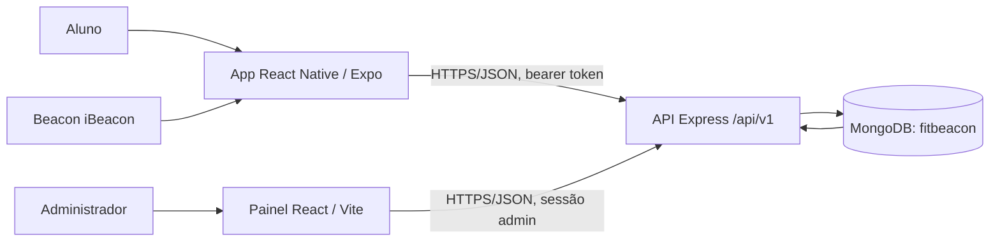
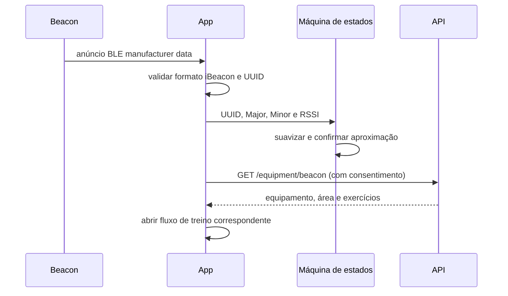
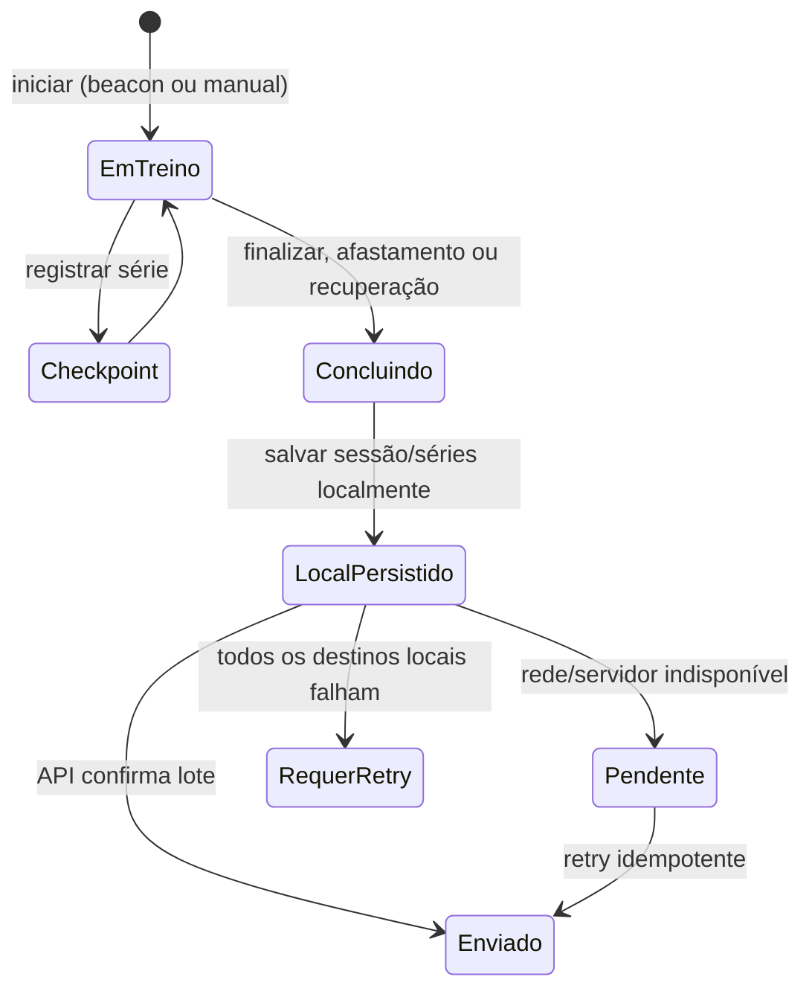

# Arquitetura FitBeacon

Este documento registra limites entre workspaces e decisões técnicas que afetam o comportamento. O resumo do produto está no [README da raiz](../README.md); guias de execução: [app](../app/README.md), [API](../api/README.md) e [painel](../web/README.md).

## Visão dos componentes

### Responsabilidades

| Componente | Responsabilidade |
|---|---|
| App | Consentimento, scan/parsing BLE, máquina de estados, catálogo do aluno, séries, cronômetro, checkpoints e fila offline |
| API | Validação de entrada, autenticação/autorização, escopo por academia, persistência, idempotência e agregações |
| MongoDB | Catálogo, contas, sessões/séries e dados demo; URI deve selecionar `fitbeacon` |
| Painel | Login admin, gestão do catálogo/mapa, filtros, KPIs e exportação |

## Decisões e razões

### Monorepo npm workspaces

`app`, `api` e `web` compartilham lockfile e comandos consistentes, mas têm scripts e tipos específicos. A raiz delega typecheck/testes aos workspaces. O painel não é um workspace da API nem tem acesso direto ao MongoDB.

### BLE processado no dispositivo

O app interpreta manufacturer data iBeacon e aplica filtro por UUID, Major/Minor e RSSI antes de obter o equipamento pela API. A máquina de estados usa leitura suavizada e histerese para reduzir detecções instáveis. A confirmação de entrada, saída, troca e timeout está detalhada no [README do app](../app/README.md). O runtime atual usa defaults da máquina; overrides por equipamento ainda não estão conectados ao runtime.

### Sessões enviadas em lote e idempotentes

Cada conclusão tem `clientSessionId` único. A API aceita lotes, para suportar sincronização posterior e impedir duplicação quando o cliente repete o envio após timeout. Reutilizar o mesmo ID com conteúdo diferente é conflito, não uma atualização silenciosa.

### Persistência local antes da rede

Séries atualizam o rascunho local; concluir persiste primeiro no armazenamento versionado do app, então tenta enviar. Arquivo usa gravação temporária e substituição; dados inválidos são isolados; há fallback SecureStore em blocos e memória/envio imediato. SecureStore é destinado a tokens e valores pequenos. Esse desenho protege sessões de indisponibilidade de rede e de exceções de escrita remota, sem afirmar que o armazenamento local sobreviverá a remoção dos dados do app.

### Consentimento e minimização

O tracking consent é exigido para lookup beacon e submissão de sessões. Relatórios administrativos usam agregações; não têm rota de listagem de alunos. CPF é protegido e mascarado em contextos individuais; não deve ir para logs/relatórios. Revogação limpa pendências locais, não apaga dados já persistidos na API.

### Tema como preferência, não regra de negócio

App e painel oferecem Sistema/Claro/Escuro e logos correspondentes. Cores são tokens; preferências não alteram sessão, sincronização nem dados. Especificação e contraste calculado: [docs/design/ESPECIFICACAO_VISUAL.md](./design/ESPECIFICACAO_VISUAL.md).

## Fluxos

### Beacon e apresentação do equipamento

### Conclusão e sincronização

Fluxo com regras e testes de regressão: [docs/design/FLUXO_CONCLUSAO_TREINO.md](./design/FLUXO_CONCLUSAO_TREINO.md).

## Dados e fronteiras de confiança

- O ID da academia é derivado do contexto autenticado no backend; chamadas não devem confiar em `gymId` do cliente para ampliar escopo.
- Validação de corpo/query usa Zod; rotas admin exigem papel admin e rotas protegidas exigem JWT.
- `UsageSession` relaciona usuário, academia, origem, equipamento/área/exercícios, horários/duração e chave de idempotência. `SetLog` guarda séries vinculadas à sessão.
- Dados seed têm `isDemo`; relatórios os omitem por padrão. Scripts de marcação/remoção estão em `api/scripts/` e precisam de verificação da base antes do uso.
- O app usa `EXPO_PUBLIC_*` e o painel `VITE_*`; ambos são configurações públicas. Segredos ficam somente no backend.

## Portas e rede de desenvolvimento

- API: `PORT` padrão `3000`; health em `/health`.
- Vite: `5173`, host configurado `0.0.0.0`.
- Metro: porta padrão Expo `8081`.
- Android USB: `adb reverse tcp:8081 tcp:8081`; para API via localhost, `adb reverse tcp:3000 tcp:3000`.
- CORS da API deve listar a origem real do painel. Rede isolada/firewall pode impedir LAN, MongoDB Atlas ou DNS.

Consulte [solução de problemas](./SOLUCAO_DE_PROBLEMAS.md) e [testes](./TESTES.md) para diagnóstico e validação.
